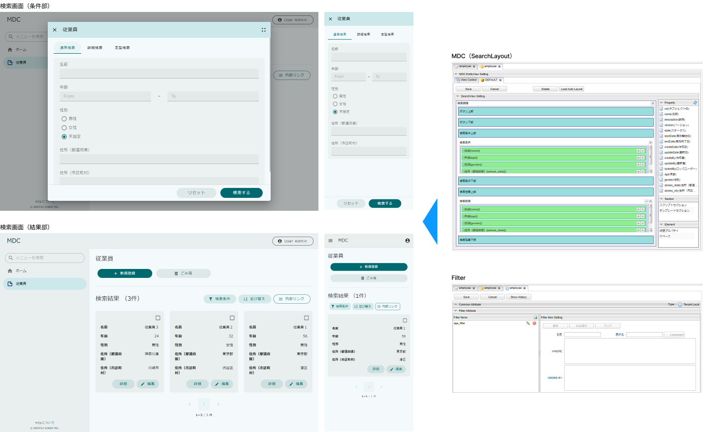
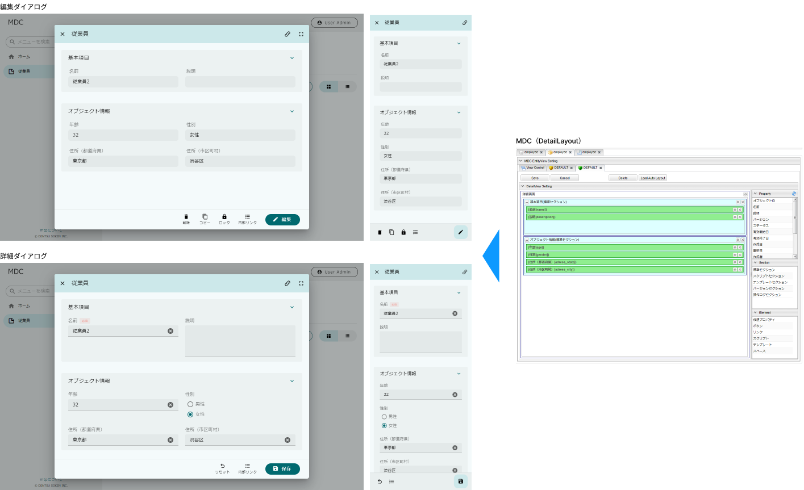
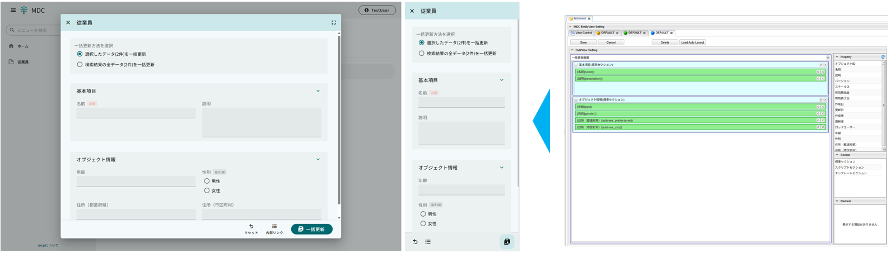
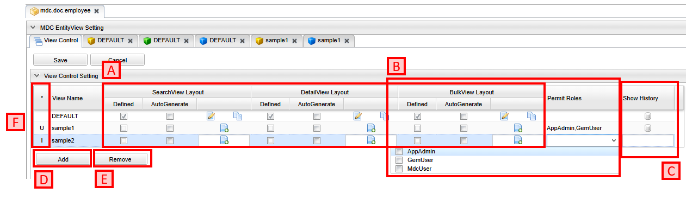

[[entityviewcontrol]]
== EntityViewの管理

EntityViewは、Entityの検索画面、詳細・編集画面、一括更新画面をカスタマイズする仕組みを提供しています。
検索画面はSearchLayoutとFilter定義を、詳細・編集画面はDetailLayoutの設定を利用して画面を生成しています。

検索一覧に選択したレコードに対して、複数の項目を同時に更新したい場合、BulkLayoutの設定を利用して一括更新画面を生成します。

=== 表示方法

サイドメニューには各エンティティに対応するメニューが表示されており、クリックすることで検索画面が表示されます。
検索画面で、新規作成ボタンをクリックしたり、検索結果の詳細画面表示アイコンをクリックしたりすることで、詳細・編集画面が表示されます。一括更新ボタンをクリックすることで、一括更新画面が表示されます。

=== MDC EntityView

MDC EntityViewは検索画面、詳細・編集画面、一括更新画面を管理する画面です。
検索画面、詳細・編集画面、一括更新画面を編集する場合はこの画面から行います。

==== MDC EntityViewの表示

MDC EntityViewを表示したいエンティティを右クリックし、`MDC EntityView` を選択します。

TIP: build.gradleで `iplass-ee-mdc` を依存関係に追加していないと、右クリック時に `MDC EntityView` は表示されません。

==== MDC EntityViewの構成

MDC EntityViewは以下の構成になっています。

.A.画面定義管理
エンティティの検索画面、詳細・編集画面、一括更新画面はレイアウトが未設定の場合、自動で生成して画面を表示します。
しかし、ロール毎に構成を変更したい場合、複数のレイアウトを設定する必要があります。
そうした場合は自動生成が行えず、例えば標準的なレイアウトをそのまま使用するロールがあった場合、エンティティ定義のプロパティ設定に変更が加わると、併せてレイアウトの修正が必要になります。

上記のような場合、この自動生成の管理機能を利用することで、特定のViewに対してのみ自動生成を行うように設定でき、標準的なレイアウトであれば個別に設定する手間を省くことができます。

Viewに対して `AutoGenerate` をチェックすることで、標準的なレイアウトを自動生成するようになります。
`Defined` にチェックがついてるViewは既にレイアウトの定義が保存されていますが、 `AutoGenerate` をチェックした場合は保存済みの定義を利用せず、自動生成を行います。

NOTE: 自動生成では `name` 、 `description` と個別の定義プロパティを対象にします。
自動生成画面の対象プロパティとして `oid` や `createDate` などのシステム項目を対象としたい場合は、
<<../../../serviceconfig/index.adoc#MdcSearchViewService, MdcSearchViewService>> の `systemProperties` や、 <<../../../serviceconfig/index.adoc#MdcDetailViewService, MdcDetailViewService>>の `systemSectionProperties` で設定を行います。

View定義が保存されている場合は編集アイコンとコピーアイコン、未保存の場合は新規作成アイコンが表示されます。
編集アイコンまたは新規作成アイコンをクリックすると、それぞれのView定義の編集画面を表示します。
コピーアイコンをクリックすると他のViewにView定義を上書きコピーします。

.B.許可ロール
Viewに対して許可ロールを指定すると、許可されたロール以外は画面表示時にエラーが発生します。
これを利用することで、特定のロールに見せたくない項目があるViewを意図せずに見られてしまう、といったことを防止できます。

NOTE: 許可ロールを利用した権限制御を行いたい場合は、Action権限、WebApi権限に対して設定が必要になります。
詳細については <<../mdcauth/index.adoc#, MDC権限制御>> を参照してください。

.C.履歴表示
保存済みの設定の履歴を表示します。

.D.Add
一覧にView（の名前）を追加します。
一覧に追加することで、存在しないViewに対しても自動生成の設定が行えるようになります。

.E.Remove
選択中のViewを一覧から削除します。
削除が可能なのは画面定義が保存されてないViewのみです。

.F.状態
Viewの状態を表します。
Addボタンで追加すると `I` 、画面定義や `AutoGenerate` を変更すると `U` 、保存済みのViewを削除すると `D` になります。

[[entityview_ai_agent_chat]]
=== AIエージェントチャット設定
[.eeonly]#EntityViewからAIエージェントとの会話を行う機能です。#

AI Agent Settingsは、SearchLayout、DetailLayout、BulkLayoutの各画面定義で個別に設定します。同じView名でも、各画面の設定は独立しています。詳細画面と詳細ダイアログでは、対象のDetailLayoutの設定を使用します。

[cols="1,4a", options="header"]
|===
|設定項目
|設定内容

|Visible
|AIエージェントチャットを有効にする場合はチェックします。

|Panel Title
|チャットパネル上部に表示するサブタイトルを設定します。未指定の場合、EntityViewのタイトルが表示されます。会話のタイトルはセッションに基づいて表示され、通常は最初のユーザーメッセージから決まります。

|AI Prompt Settings
a|EntityViewから利用するAIエージェントプロンプト定義を設定します。複数のプロンプトを設定した場合、ユーザーはチャットパネルから利用するエージェントを選択できます。

各プロンプトに対して、以下を設定します。

* AI Agent Prompt: 利用するAIエージェントプロンプト定義を選択します。
* Message Key: AIの応答がJSON形式の場合に、画面に表示するメッセージの値を取り出すキーパスを設定します。ドット区切りで指定できます（例：`result.message`）。未指定の場合は応答文字列全体を表示します。Message Keyを指定した場合、AIの応答が有効なJSONでない、または指定したパスが存在しないとエラーになります。
|===

.AIエージェントチャットの動作
* EntityViewにAIエージェントチャットを開くボタンが表示されます。
* ボタンを押すとチャットパネルが開き、利用可能なエージェントを選択して会話できます。
* 新しい会話の作成、既存セッションの選択、会話履歴の表示、セッションのアーカイブを行えます（アーカイブしたセッションは通常の一覧に表示されません）。

[NOTE]
====
* AIエージェントチャットを利用するには、事前にAIエージェントに対応したプラットフォームを設定したAIプロンプト定義が必要です。AIプロンプト定義については<<../../ai/index.adoc#prompt_setting_prompt_definition, プロンプト設定>>を参照してください。
* Navigationの `AI Chat` パーツで現在のユーザーが利用可能なプロンプトも、EntityViewから利用できます。Navigationの設定については<<../navigation/index.adoc#aichat, AI Chat>>を参照してください。
* 画面データや会話内容がAIサービスへ送信される場合があります。送信対象となる情報を確認したうえで利用してください。
* AIエージェントチャットのユーザーメッセージ最大長、会話の最大ターン数、セッション一覧のページサイズは、<<../../../serviceconfig/index.adoc#AiApplicationPolicyService, AiApplicationPolicyService>>で設定できます。
====

[IMPORTANT]
====
Structured Outputを利用する場合は、利用するAIプラットフォームがStructured Outputに対応している必要があります。JSON Schemaには、設定した `Message Key` で応答から取得する項目を含めてください。JSON Schemaの項目と `Message Key` のパスが一致するように設定します（例：JSON Schemaに `message` を定義し、`Message Key` に `message` を指定）。

`Message Key` には、必要以上に深い階層のパスを指定しないでください。
====

.formDataと会話セッション
メッセージを送信するたびに、フロントエンドはその時点の画面データを `formData` としてバックエンドに送信します。これはデータベースから最新データを再取得するものではありません。また、AIエージェントチャットは画面データが前回から変更されたかどうかを判定しません。

`formData` の内容は画面によって異なります。詳細画面では表示・編集中のEntity、一括更新画面では一括更新フォームのEntity、検索画面では現在表示されているページの検索結果が含まれます。検索条件に一致するすべてのレコードや、選択したレコードだけを表すものではありません。同じ会話セッションで画面データを変更した後にメッセージを送信すると、変更後の画面データが送信されます。

`formData` をAIプラットフォームに送信するかどうかは、AIプロンプト定義のPromptで制御します。Prompt Placeholderに `formData` を定義し、プロンプトテンプレートで参照すると、画面データをプロンプトに含められます。

会話履歴と画面データの不整合を避けるため、`formData` は初回のメッセージでのみプロンプトに含めることを推奨します。その場合はPrompt Placeholderに `messageHistory` も定義し、`messageHistory` が空の場合に限って `formData` をプロンプトに含めるようテンプレートを設定してください。`messageHistory` は今回のメッセージより前の会話履歴です。

画面データを変更した後、その新しいデータをAIに参照させる場合は、新しいセッションを開始することを推奨します。
